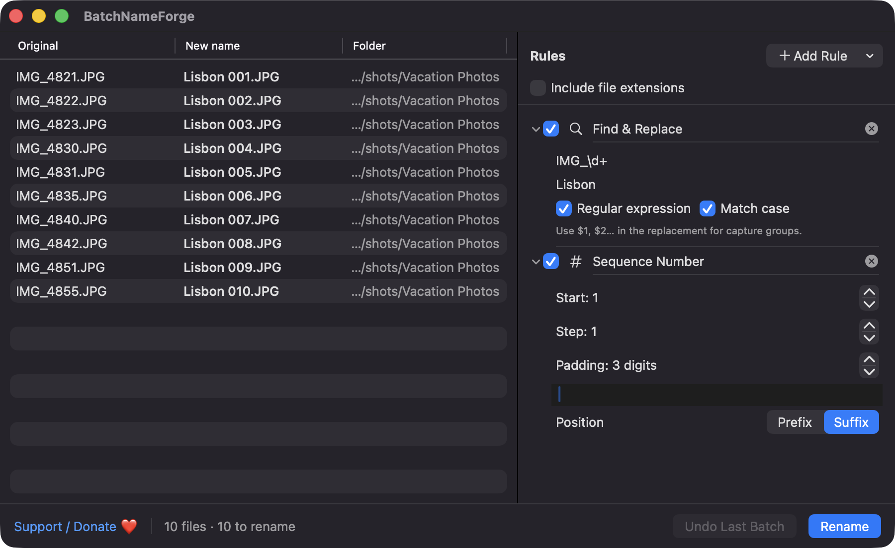
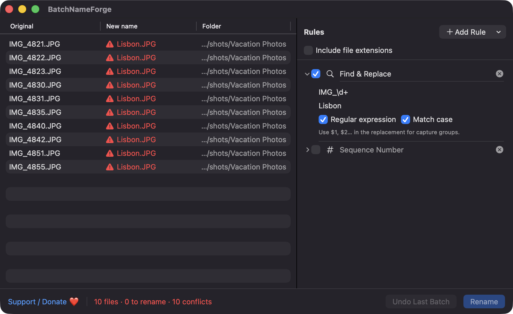
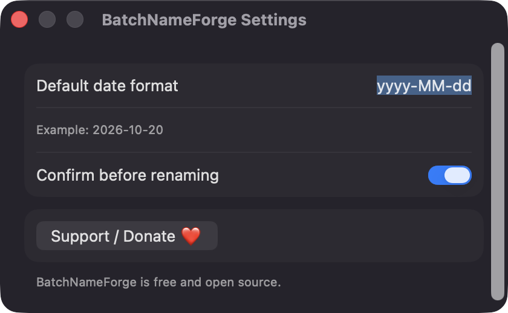

# BatchNameForge

**🌐 Website:** [turhe123.github.io/batch-name-forge](https://turhe123.github.io/batch-name-forge/)

Drop a pile of files and rename them all with stackable rules and a live before and after preview.


## Why

BatchNameForge is a free, open-source, 100% native, backend-free alternative to paid utilities in the *Files & Conversion* category. It was inspired by the idea behind Better Rename ($20 one-time), which popularized chaining many small rename actions. Everything runs locally on your Mac, with no accounts, servers or subscriptions.

## Features

- **Drop files or folders** onto the window, or use **Open Files…** (⌘O). Choosing a regular folder adds the files inside it (hidden files are skipped when expanding a folder). Duplicates are ignored.
- **Stackable rules**, applied top to bottom, each of which can be reordered by dragging, enabled/disabled, or removed:
  - Find & Replace, literal or regular expression, with optional case matching and capture-group templates
  - Add Prefix / Suffix
  - Remove Characters (a set of characters, first N, or last N)
  - Change Case (lowercase, UPPERCASE, Title Case, Sentence case)
  - Sequence Number (start, step, zero padding, separator, prefix or suffix)
  - Modification Date, Creation Date, and Capture Date (EXIF) with a custom date format
  - Trim Whitespace, with optional collapsing of repeated spaces
- **Live preview** table with Original, New name and Folder columns. Previews are computed off the main thread, so large batches stay responsive.
- **Collision detection**: duplicate target names within the batch and existing files in the destination folder are flagged, and renaming is blocked until they are resolved. Empty names and names over 255 bytes are flagged too.
- **Inline validation**: invalid regular expressions and empty date formats are reported in the rule editor instead of crashing.
- **Extensions are kept** unless you turn on "Include file extensions".
- **Safe renaming**: files are moved through temporary names in two phases, so swaps and chained names work. If any move fails, everything already moved is rolled back and the failing file is reported.
- **Undo last batch** (⌘Z), which is kept in memory for the session.
- **Presets**: save the current rule stack under a name, load it later, or delete it. Presets are stored as JSON in Application Support.
- **Settings**: default date format and whether to confirm before renaming.
- Invalid characters such as `/` and `:` are replaced with `-`, and control characters are removed.
- Rename with ⌘Return. Clear the list with ⇧⌘⌫.

## Screenshots

<p align="center"></p>

<p align="center"><em>Ten camera files get renamed to Lisbon 001–010 by a regex Find Replace rule stacked with a Sequence Number rule, with a live before-and-after preview.</em></p>

<p align="center"></p>

<p align="center"><em>With the sequence rule turned off, every file would get the same name, so BatchNameForge flags all ten conflicts and won&#x27;t rename until they&#x27;re fixed.</em></p>

<p align="center"></p>

<p align="center"><em>Settings let you pick the default date format and choose whether to confirm before renaming.</em></p>

## Install

1. Download `BatchNameForge-macOS.zip` from the [latest release](https://github.com/turhe123/batch-name-forge/releases/latest).
2. Unzip it and move `BatchNameForge.app` to `/Applications`.
3. Because the app is open source and not notarized, clear the quarantine attribute:

   ```bash
   xattr -cr /Applications/BatchNameForge.app
   ```

4. The first time, right-click the app and choose **Open**.

Requires macOS 14.0 or later.

## Build from source

```bash
brew install xcodegen
xcodegen generate
xcodebuild -project BatchNameForge.xcodeproj -scheme BatchNameForge -configuration Release -derivedDataPath ./build build
```

The app is produced at `build/Build/Products/Release/BatchNameForge.app`.

## Permissions

BatchNameForge requests no special permissions. It does not use Accessibility, Screen Recording, Microphone, Camera, Contacts or network access. The app is not sandboxed, so it can rename the files and folders you choose directly. It only touches:

- the files you drop in or pick with the open panel (read names, dates and EXIF capture date; rename them),
- `~/Library/Application Support` for saved presets, and
- the standard user defaults for the two settings.

## Built with AI

BatchNameForge was written by [Claude Code](https://claude.com/claude-code) inside an automated pipeline, from a plain-English spec. No code, binaries or assets from any commercial app were used; it is a clean-room reimplementation of a feature set, not a copy.

What that means in practice:

- The full source is in this repo under the MIT license. Read it before you run it.
- No network calls, no analytics, no third-party dependencies. Only Apple frameworks.
- Ad-hoc signed and not notarized, which is why Gatekeeper warns on first launch.
- It has had less human review than a hand-written app. Bug reports and pull requests are welcome.

## Support ❤️

BatchNameForge is free. If it saves you time, you can support its development:

[Support Or (Leo) Davidai ❤️ on Ko-fi](https://ko-fi.com/leodavidai)

The app also has a **Support / Donate ❤️** button in the Help menu and in Settings.

## License

MIT © Or Davidai Bachar

## More free Mac apps

Prefer something that runs in the browser? The same pipeline builds [free, private web tools](https://turhe123.github.io/web-tools/): PDF, image, developer, data and audio tools, nothing uploaded.
